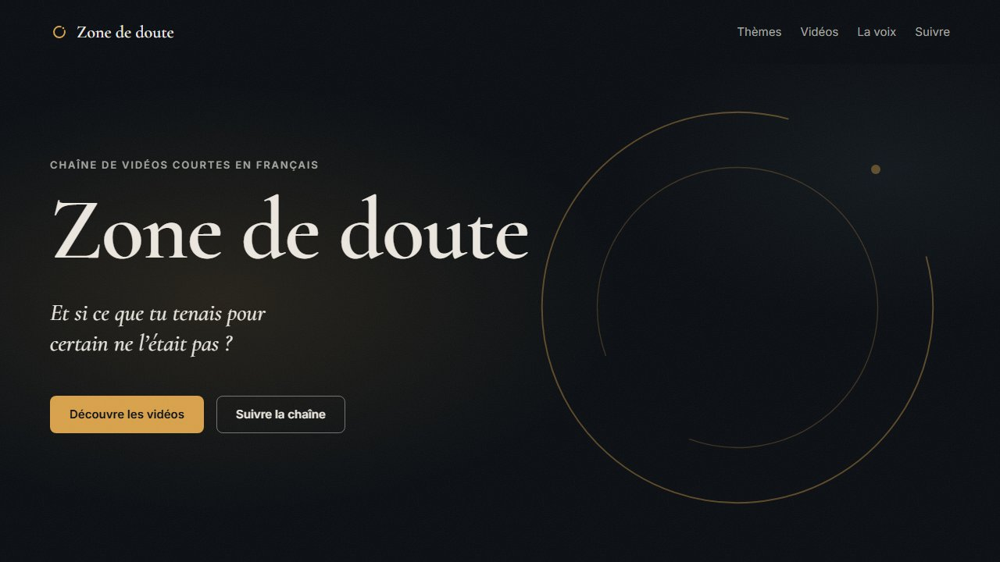

# zone-de-doute

Mini-site de la chaîne Zone de doute (HTML et CSS)

**En ligne&nbsp;:** https://cherife110.github.io/zone-de-doute/

Une page unique qui présente Zone de doute, une chaîne de vidéos courtes en français sur les expériences de pensée, les paradoxes, la philosophie et les mystères de l’existence.

## Technique

- HTML sémantique et CSS moderne, sans framework ni JavaScript
- Page fluide de 375 à 1280 px&nbsp;: `clamp()` et grilles `auto-fit`, sans media query de mise en page
- Accessibilité&nbsp;: contrastes mesurés (WCAG AA), lien d’évitement, navigation au clavier, `prefers-reduced-motion`
- Polices auto-hébergées en woff2&nbsp;: Cormorant Garamond et Inter, sous licence SIL Open Font License 1.1 (voir `fonts/`)

## Fichiers

| Fichier | Rôle |
|---|---|
| `index.html` | La page |
| `style.css` | Les styles |
| `fonts/` | Les polices et leurs licences |
| `img/` | Les miniatures des vidéos |
| `favicon.svg` | L’icône de l’onglet |
| `capture.jpg` | La capture ci-dessus |
